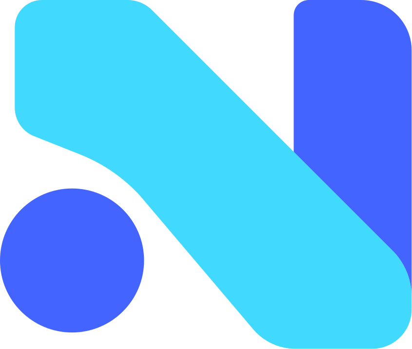
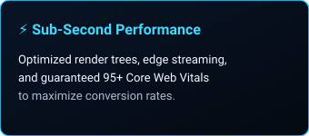
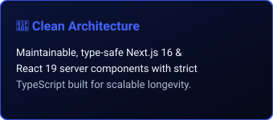
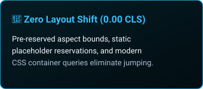
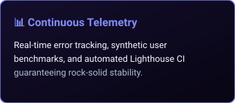
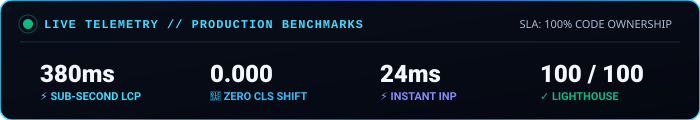
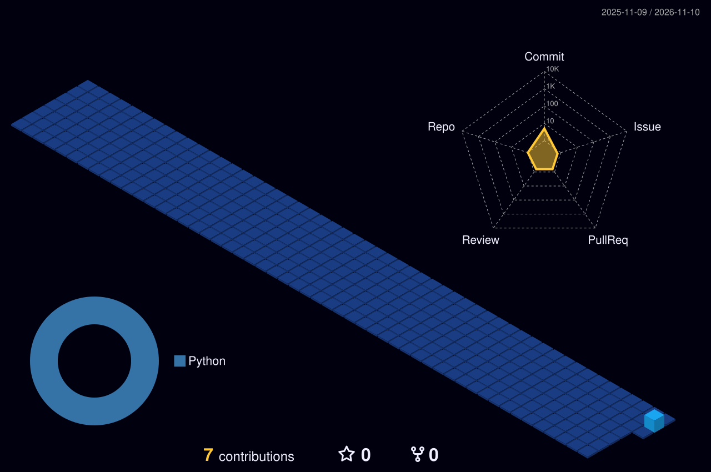

<!-- Profile README for DotNif -->

  
   

  

  

    <strong>Engineering high-performance web & e-commerce built for growth</strong> 
    <em>Boutique digital studio specializing in sub-second Next.js architectures, bespoke luxury UI, and flexible headless commerce.</em>
  

  

    <a href="https://dotnif.vercel.app/" target="_blank">🌐 Website</a> •
    <a href="https://dotnif.vercel.app/services" target="_blank">⚡ Services</a> •
    <a href="https://dotnif.vercel.app/projects" target="_blank">🚀 Case Studies</a> •
    <a href="https://dotnif.vercel.app/about" target="_blank">🎯 About Us</a> •
    <a href="https://dotnif.vercel.app/contact" target="_blank">✉️ Get in Touch</a> •
    <a href="mailto:hello@dotnif.com">📧 hello@dotnif.com</a>
  

   
  

---

## 🎯 Engineering Pillars

  
  
  
  

---

## 🛠 Production Stack

### 🌐 Core Web Architecture

### ⚙️ E-Commerce & CMS Platforms

### 🎨 Infrastructure & Motion

---

## 🚀 Featured Deployments & Case Studies

| Project | Domain | Live Architecture | Benchmark |
| :--- | :--- | :--- | :--- |
| **Daddu Charger** | Gaming Hardware | [Live Next.js Deployment ↗](https://dadducharger.by.muhammadawaisweb.dev/) • [Original ↗](https://dadducharger.com/) | 380ms LCP • High-FPS Motion |
| **Zero Lifestyle** | Consumer Electronics | [Live Next.js Redesign ↗](https://zeroredesign.by.muhammadawaisweb.dev/) • [Original ↗](https://zerolifestyle.co/) | +38% Checkout Lift • Headless Store |
| **Jan Franko** | Sports & Heritage | [Live Next.js Deployment ↗](https://jan-franko-next.vercel.app/) • [Original ↗](https://janfranko.com/) | 0.00 CLS • Bespoke Luxury UI |

---

## 📈 Production Telemetry & Standards

  

 

  <table border="0">
    <tr>
      <td align="left">
        <ul>
          <li><strong>Sub-Second LCP Guarantee:</strong> Edge SSR routing &amp; tree-shaken hydration bundles.</li>
          <li><strong>Zero Layout Shift:</strong> Static placeholder reservations &amp; modern CSS container queries.</li>
          <li><strong>Complete Code Ownership:</strong> Clean, maintainable repos with zero vendor lock-in.</li>
        </ul>
      </td>
      <td align="left">
        <ul>
          <li><strong>Rapid 1-3 Week Sprints:</strong> Direct senior builder access without agency middlemen.</li>
          <li><strong>Automated Telemetry:</strong> Synthetic Lighthouse CI benchmarks &amp; error monitoring.</li>
          <li><strong>Mutual NDA Protected:</strong> Executed before code access or technical intake.</li>
        </ul>
      </td>
    </tr>
  </table>

---

## 📊 GitHub Analytics

<h3 align="center">3D Contributions</h3>

  

  <table border="0">
    <tr>
      <td width="50%" align="center">
        
      </td>
      <td width="50%" align="center">
        
      </td>
    </tr>
    <tr>
      <td colspan="2" align="center">
        
      </td>
    </tr>
  </table>

---

## 💬 Initiate Project Discovery

Partner with our engineering team to design, build, and scale high-conversion web architectures.

- **Website**: [dotnif.vercel.app](https://dotnif.vercel.app/)
- **Project Discovery**: [dotnif.vercel.app/contact](https://dotnif.vercel.app/contact)
- **Direct Email**: [hello@dotnif.com](mailto:hello@dotnif.com) • [support@dotnif.com](mailto:support@dotnif.com)
- **Response SLA**: Every inquiry receives a direct technical review within 24 business hours.

  © DotNif Studio. Built for velocity, engineered for conversion.

